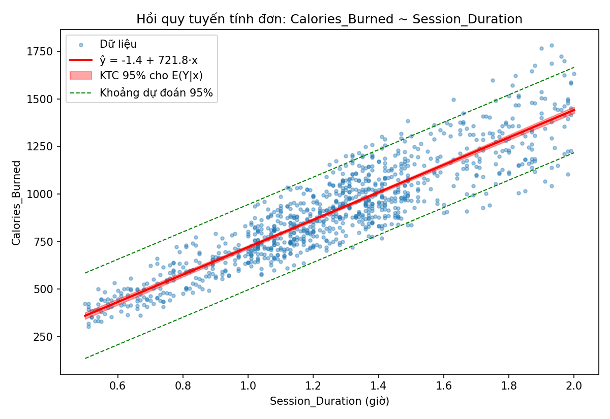

# Chương 4 (phần 1). Hồi quy tuyến tính đơn

## 4.1. Mô hình và ước lượng bình phương tối thiểu

$$Y_i=\beta_0+\beta_1X_i+\varepsilon_i,\quad \varepsilon_i\sim N(0,\sigma^2)\ \text{độc lập}$$

với $Y$ = Calories_Burned, $X$ = Session_Duration (giờ), $n=973$. Ước lượng OLS:

$$b_1=\frac{S_{xy}}{S_{xx}},\qquad b_0=\bar y-b_1\bar x,\qquad s^2=\frac{SSE}{n-2}$$

Kết quả: $b_0=-1.4465$, $b_1=721.7860$, $s=114.2044$. Phương trình hồi quy: $\hat y=-1.45+721.79\,x$.
Ý nghĩa $b_1$: mỗi giờ tập thêm, calo đốt tăng trung bình khoảng 721.8.

## 4.2. Suy diễn về hệ số

$SE(b_1)=s/\sqrt{S_{xx}}$, $SE(b_0)=s\sqrt{1/n+\bar x^2/S_{xx}}$; $\;T=\frac{b_j-\beta_j}{SE(b_j)}\sim t_{n-2}$; KTC: $b_j\pm t_{n-2;1-\alpha/2}SE(b_j)$ với $t_{n-2;0.975}=1.9624$.

| Hệ số | Ước lượng | Sai số chuẩn | t (H0: β=0) | P-giá trị | KTC 95% cận dưới | KTC 95% cận trên |
|---|---|---|---|---|---|---|
| β0 (Intercept) | -1.446459 | 13.907389 | -0.104007 | 0.917186 | -28.738459 | 25.845542 |
| β1 (Session_Duration) | 721.786016 | 10.678576 | 67.591970 | 0.000000 | 700.830270 | 742.741762 |

Kiểm định $H_0:\beta_1=0$: $T=67.592$, $P=0$ → bác bỏ $H_0$ (β₁ ≠ 0, Session_Duration có ý nghĩa giải thích Calories_Burned).

## 4.3. Bảng ANOVA và kiểm định F

| Nguồn | Tổng bình phương | Bậc tự do | Trung bình bình phương | F | P-giá trị |
|---|---|---|---|---|---|
| Hồi quy (SSR) | 59587643.6038 | 1 | 59587643.6038 | 4568.6744 | 0.0000 |
| Phần dư (SSE) | 12664417.7878 | 971 | 13042.6548 | nan | nan |
| Tổng (SST) | 72252061.3916 | 972 | nan | nan | nan |

$F=MSR/MSE=4568.674$, giá trị tới hạn $F_{1,971;0.95}=3.851$, $P=0$. Trong hồi quy đơn $F=T^2$ nên kiểm định F tương đương t-test của $\beta_1$.
$R^2=SSR/SST=0.8247$: mô hình giải thích 82.5% biến thiên của Calories_Burned.

## 4.4. Khoảng tin cậy cho trung bình và khoảng dự đoán

Tại $x_0$: $\hat y_0=b_0+b_1x_0$;
KTC cho $E(Y|x_0)$: $\hat y_0\pm t\,s\sqrt{\frac1n+\frac{(x_0-\bar x)^2}{S_{xx}}}$;
khoảng dự đoán cho một quan sát mới $Y_0$: $\hat y_0\pm t\,s\sqrt{1+\frac1n+\frac{(x_0-\bar x)^2}{S_{xx}}}$ (luôn rộng hơn vì thêm phương sai sai số $\sigma^2$).

| x0 (giờ) | ŷ0 | KTC E(Y|x0) dưới | KTC E(Y|x0) trên | KTD dự đoán Y dưới | KTD dự đoán Y trên | Ngoài miền dữ liệu |
|---|---|---|---|---|---|---|
| 0.75 | 539.89 | 527.08 | 552.71 | 315.41 | 764.38 |  |
| 1.00 | 720.34 | 711.37 | 729.31 | 496.04 | 944.64 |  |
| 1.25 | 900.79 | 893.60 | 907.97 | 676.55 | 1125.02 |  |
| 1.50 | 1081.23 | 1072.42 | 1090.05 | 856.94 | 1305.52 |  |
| 2.00 | 1442.13 | 1424.97 | 1459.28 | 1217.35 | 1666.90 |  |

*Tính đủ của mô hình (phần dư, ln Y) và tương quan được phân tích ở mục 4.5 (file `06_chap4_corr.md`).*
