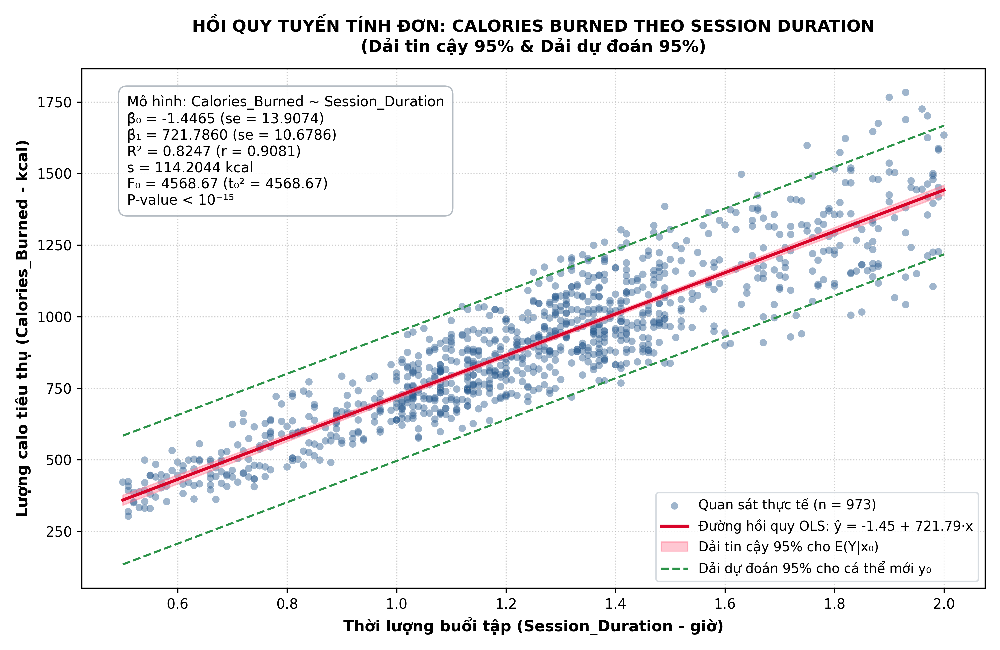

# CHƯƠNG 4.1: HỒI QUY TUYẾN TÍNH ĐƠN (MÔ HÌNH & SUY LUẬN)
**Người thực hiện**: Nguyễn Thị Thảo | **Reviewer**: Khánh

## 1. Cơ sở lý thuyết toán học (Định lý 1, 3, 4, 5, 6, 7, 8)

### 1.1. Mô hình và Các giả thiết cổ điển Gauss-Markov
Mô hình hồi quy tuyến tính đơn có dạng:
$$Y_i = \beta_0 + \beta_1 X_i + \varepsilon_i, \quad i = 1, 2, \dots, n$$
Trong đó:
- $Y$: Biến phụ thuộc (`Calories_Burned` - kcal).
- $X$: Biến độc lập (`Session_Duration` - giờ).
- $\beta_0, \beta_1$: Các hệ số hồi quy (tham số lý thuyết cần ước lượng).
- $\varepsilon_i$: Sai số ngẫu nhiên.

**Các giả thiết Gauss-Markov chuẩn:**
1. **Kỳ vọng sai số triệt tiêu**: $E(\varepsilon_i) = 0, \forall i$.
2. **Phương sai thuần nhất (Homoscedasticity)**: $Var(\varepsilon_i) = \sigma^2, \forall i$.
3. **Không tự tương quan (No autocorrelation)**: $Cov(\varepsilon_i, \varepsilon_j) = 0, \forall i \neq j$.
4. **Sai số chuẩn tắc**: $\varepsilon_i \overset{iid}{\sim} \mathcal{N}(0, \sigma^2)$.

### 1.2. Ước lượng Bình phương nhỏ nhất (OLS - Định lý 1 - BLUE)
Cực tiểu hóa tổng bình phương sai số:
$$L(\beta_0, \beta_1) = \sum_{i=1}^n (y_i - \beta_0 - \beta_1 x_i)^2 \longrightarrow \min$$
Hệ phương trình chuẩn:
$$\begin{cases} \sum y_i = n \hat{\beta}_0 + \hat{\beta}_1 \sum x_i \\ \sum x_i y_i = \hat{\beta}_0 \sum x_i + \hat{\beta}_1 \sum x_i^2 \end{cases}$$
Nghiệm duy nhất (Định lý Gauss-Markov - Ước lượng tuyến tính không chệch tốt nhất - BLUE):
$$\hat{\beta}_1 = \frac{S_{xy}}{S_{xx}}, \qquad \hat{\beta}_0 = \bar{y} - \hat{\beta}_1 \bar{x}$$
với các tổng bình phương độ lệch mẫu:
- $S_{xx} = \sum_{i=1}^n (x_i - \bar{x})^2 = \sum x_i^2 - n \bar{x}^2$
- $S_{yy} = \sum_{i=1}^n (y_i - \bar{y})^2 = \sum y_i^2 - n \bar{y}^2$
- $S_{xy} = \sum_{i=1}^n (x_i - \bar{x})(y_i - \bar{y}) = \sum x_i y_i - n \bar{x}\bar{y}$

### 1.3. Phân phối của các ước lượng và Ước lượng phương sai sai số (Định lý 3 & 4)
Dưới giả thiết phân phối chuẩn của sai số:
$$\hat{\beta}_1 \sim \mathcal{N}\left(\beta_1, \frac{\sigma^2}{S_{xx}}\right), \qquad \hat{\beta}_0 \sim \mathcal{N}\left(\beta_0, \sigma^2 \left[\frac{1}{n} + \frac{\bar{x}^2}{S_{xx}}\right]\right)$$
$$Cov(\hat{\beta}_0, \hat{\beta}_1) = -\frac{\bar{x}\sigma^2}{S_{xx}}$$
Ước lượng không chệch của $\sigma^2$ (Định lý 4):
$$s^2 = MSE = \frac{SSE}{n - 2} = \frac{S_{yy} - \hat{\beta}_1 S_{xy}}{n - 2}$$
và thống kê $\frac{(n-2)s^2}{\sigma^2} \sim \chi^2(n-2)$, độc lập thống kê với $(\hat{\beta}_0, \hat{\beta}_1)$.

## 2. Kết quả thực nghiệm trên dữ liệu phòng Gym

- Cỡ mẫu: $n = 973$.
- $\bar[1.69 1.3  1.11 0.59 0.64 1.59 1.49 1.27 1.03 1.08 0.82 1.15 1.24 1.18
 1.35 1.13 1.33 1.19 1.13 1.37 1.5  1.12 1.17 0.78 1.25 1.42 0.73 1.48
 1.64 1.29 1.27 1.03 1.48 1.04 1.52 1.32 1.26 1.34 1.3  1.31 1.48 1.08
 1.45 1.14 1.5  1.2  0.84 1.41 1.23 1.03 1.42 1.67 1.13 1.26 0.81 1.47
 1.4  1.08 1.67 0.56 1.04 1.08 1.75 1.23 1.97 0.62 1.99 0.89 1.81 1.32
 1.73 1.47 1.07 1.08 1.13 1.08 1.37 0.63 1.18 1.87 1.2  1.78 0.86 1.08
 1.13 1.27 1.34 1.45 1.09 0.64 1.93 1.8  1.26 1.26 1.25 0.58 1.29 1.33
 1.15 1.97 1.16 1.49 1.2  0.54 0.97 1.79 0.51 1.74 1.39 1.01 1.44 1.41
 1.78 1.72 1.01 0.55 1.09 1.69 1.41 1.02 1.22 1.29 1.   1.28 1.97 1.28
 0.51 1.98 0.66 1.61 1.24 0.68 1.91 1.38 1.42 1.17 1.31 0.66 1.24 1.69
 0.89 1.26 1.38 1.42 0.97 1.53 1.28 1.07 0.7  1.46 1.46 0.54 1.95 1.32
 0.83 1.42 1.23 0.67 1.3  1.02 1.08 1.49 1.36 1.57 1.55 1.04 1.58 1.14
 1.27 0.92 1.08 1.09 1.52 1.1  1.46 1.2  1.58 0.68 1.1  1.05 0.83 1.54
 1.81 1.28 1.66 1.44 1.87 1.2  1.37 1.09 1.1  1.23 1.23 1.33 1.03 0.56
 1.45 1.71 1.18 1.26 1.03 1.84 1.49 1.08 1.79 1.95 1.2  1.18 1.37 1.71
 1.47 1.08 1.83 1.28 1.11 1.24 1.13 1.28 1.35 1.19 1.21 1.87 0.63 1.57
 1.46 1.8  1.09 1.   1.45 1.87 1.16 1.44 1.29 1.55 1.36 1.2  1.13 1.6
 0.99 1.29 0.82 1.31 1.11 1.41 1.16 0.77 1.4  0.81 1.09 0.93 1.33 1.04
 1.39 1.11 1.01 1.31 1.69 1.33 1.15 0.52 1.06 0.96 1.31 1.34 1.01 1.36
 1.07 1.52 1.03 1.63 1.4  1.36 0.92 1.12 1.52 0.81 1.97 1.48 1.54 0.8
 1.39 1.35 0.83 0.63 1.47 1.79 1.36 0.81 1.1  1.37 0.9  1.13 1.42 1.41
 1.4  1.4  1.07 1.48 0.53 1.03 0.77 1.62 1.3  1.94 1.46 1.36 1.14 1.85
 1.43 1.67 1.83 1.01 0.81 1.4  1.   1.98 1.84 1.25 1.37 1.16 1.3  1.85
 1.04 1.13 1.14 1.03 1.48 1.42 0.69 1.42 1.82 1.22 0.81 0.96 1.49 1.35
 1.2  1.17 1.42 1.44 1.07 1.7  0.83 1.48 1.43 1.14 1.31 1.15 1.99 0.64
 1.41 1.49 1.13 0.84 0.67 1.38 1.56 0.64 0.9  0.57 1.37 0.92 1.21 0.7
 1.93 0.92 1.14 1.88 1.33 1.3  1.35 1.42 1.19 1.6  1.43 1.   1.26 1.37
 1.25 1.03 1.86 0.93 1.15 0.85 1.37 1.22 1.37 1.5  0.73 1.09 1.31 1.9
 1.24 1.18 1.38 1.93 1.52 1.23 1.9  1.49 1.14 1.04 1.2  0.6  1.77 1.
 1.48 1.32 1.4  0.5  1.45 0.73 1.59 1.28 0.72 0.88 1.49 1.25 1.27 1.98
 1.35 1.65 1.84 1.28 1.86 0.62 1.51 0.69 1.93 1.54 1.74 1.43 0.94 0.51
 1.06 1.43 1.01 1.39 1.8  1.14 1.98 1.04 1.8  1.58 1.22 1.4  1.21 0.66
 1.2  0.88 0.69 0.77 0.76 0.85 1.2  1.7  1.35 1.88 1.25 0.88 1.24 1.31
 1.13 1.47 1.25 1.31 1.46 0.83 1.17 1.18 1.41 1.31 1.62 0.7  1.33 1.82
 1.09 0.86 1.21 0.97 0.97 1.05 0.91 1.34 1.54 1.66 1.36 0.74 1.1  1.07
 1.27 1.41 1.7  1.06 0.84 0.66 1.29 1.87 1.22 1.28 1.38 1.08 1.3  0.87
 0.61 1.48 1.08 1.44 0.81 0.97 1.37 1.96 1.85 1.98 1.41 0.85 1.28 1.38
 1.66 0.93 1.42 1.29 1.1  1.37 1.02 0.9  0.52 1.34 1.29 1.68 1.74 1.37
 0.61 1.15 1.01 0.72 1.77 1.46 1.9  1.45 1.27 1.13 1.83 1.1  1.03 1.48
 1.17 1.34 1.37 1.36 1.25 1.27 0.92 1.17 1.02 1.4  0.61 1.91 1.16 0.97
 1.08 1.37 1.04 1.42 0.77 0.67 1.29 1.32 1.14 0.54 1.34 1.36 1.87 1.45
 1.35 1.26 1.03 1.23 1.29 1.27 1.03 1.08 1.36 1.47 1.56 1.38 0.68 1.83
 1.01 1.24 1.14 1.76 1.41 0.69 0.89 1.83 1.25 1.06 1.03 1.46 1.14 1.87
 1.36 0.84 0.54 1.78 1.03 0.59 1.67 1.81 1.73 1.71 1.25 1.42 1.06 1.75
 1.19 1.29 1.4  0.55 1.19 1.52 1.97 0.76 0.89 0.95 1.17 1.67 1.12 1.18
 1.7  1.48 1.28 1.3  1.26 1.13 1.15 1.38 1.58 1.46 1.06 1.41 1.08 0.75
 0.72 1.28 1.88 0.52 1.27 1.8  0.51 1.47 1.17 1.29 1.3  1.38 1.1  1.31
 0.82 1.1  1.17 1.34 1.13 1.88 0.71 1.12 1.5  0.97 1.72 1.6  1.45 1.38
 1.42 1.51 1.   1.32 1.02 1.27 1.13 1.41 1.48 1.38 0.99 1.18 1.21 1.17
 1.13 1.46 1.02 1.37 1.2  1.14 1.98 1.14 1.67 1.19 1.13 1.37 1.24 1.11
 1.14 1.2  1.07 1.37 1.42 0.8  1.18 0.85 1.45 1.29 1.34 1.8  1.9  1.35
 1.29 1.   1.07 0.54 1.38 1.71 1.36 1.36 1.27 1.36 1.44 0.89 1.26 0.58
 2.   0.57 1.02 1.38 1.61 1.06 1.41 1.76 1.75 1.36 1.81 1.06 1.36 0.97
 0.51 1.17 1.41 1.49 1.16 1.45 0.75 1.49 1.02 1.36 1.32 1.52 0.55 0.63
 0.91 0.93 0.79 1.51 1.11 0.93 1.49 1.19 1.45 0.84 1.47 1.46 0.55 1.64
 0.76 1.29 1.48 0.9  1.79 1.08 1.22 1.72 1.03 1.66 1.37 1.48 0.89 1.29
 1.9  1.31 1.34 0.66 1.47 1.01 1.77 1.35 0.71 0.79 0.74 0.91 0.56 1.93
 1.42 1.11 0.6  1.76 1.33 0.87 1.41 1.19 0.53 1.39 1.17 1.08 1.67 1.62
 1.38 1.13 1.09 1.26 1.42 1.07 1.33 1.78 1.23 1.22 1.19 0.96 1.08 0.74
 1.1  1.12 1.35 1.47 1.94 1.76 1.63 1.24 1.05 1.69 1.37 0.99 1.21 1.15
 1.76 1.22 1.32 0.74 1.   1.8  1.   1.03 1.99 0.71 1.34 1.34 1.15 1.07
 1.06 1.1  0.72 1.77 1.04 0.74 1.38 1.35 1.01 1.7  1.94 1.3  1.65 0.82
 0.77 1.28 1.87 1.18 0.68 1.03 1.5  0.91 1.59 1.88 1.07 1.65 1.49 1.85
 1.03 1.33 1.03 1.58 1.22 0.77 0.76 1.29 1.09 1.32 1.72 0.73 1.15 0.68
 1.83 1.63 1.28 1.46 0.66 1.05 1.65 1.38 0.94 1.42 1.88 0.96 0.75 1.32
 1.93 0.79 0.77 1.19 0.72 1.05 1.24 1.26 1.13 1.15 1.56 1.31 1.66 1.02
 0.94 1.13 0.89 1.31 0.95 0.61 1.97 1.14 1.72 0.76 1.3  1.01 1.04 1.34
 0.85 0.57 1.18 1.32 1.77 1.99 1.38 1.02 1.05 1.2  1.91 1.21 1.39 1.14
 1.2  1.03 1.96 1.24 1.32 1.83 0.81 1.16 1.17 1.02 1.57 1.39 1.99 0.58
 1.87 1.12 1.57 1.38 1.72 1.1  0.75] = 1.2564$ giờ, $\bar[1313.  883.  677.  532.  556. 1116. 1385.  895.  719.  808.  593.  865.
 1013.  794. 1195.  740. 1111.  884.  742. 1030. 1048.  875.  848.  721.
  925. 1080.  502.  989. 1104.  871.  964.  654. 1046.  816. 1237. 1162.
  879. 1069. 1072. 1057.  969.  734.  962.  730. 1304.  956.  772. 1016.
  836.  742. 1122. 1133.  750. 1046.  506. 1318. 1021.  832. 1150.  440.
  580.  666. 1299.  773. 1418.  421. 1587.  627. 1358. 1176. 1004.  963.
  786.  743.  777.  663.  875.  363.  864. 1262.  990. 1129.  546.  751.
  744. 1003. 1150. 1103.  917.  416. 1688. 1231.  936.  924. 1052.  441.
  805. 1106.  735. 1625.  804. 1073.  805.  420.  667. 1369.  424. 1404.
 1020.  677.  979.  819. 1357. 1315.  685.  446.  888. 1357. 1303.  790.
  858. 1071.  639.  824. 1701.  880.  408. 1479.  500. 1373.  870.  458.
 1503. 1207.  837.  811. 1041.  451.  756. 1042.  608. 1046.  854.  958.
  678. 1265.  877.  885.  624. 1038. 1214.  499. 1150. 1082.  530.  886.
  913.  362. 1201.  711.  832. 1151. 1070. 1119. 1074.  837.  967.  844.
  852.  574.  813.  680. 1195.  644.  925.  778. 1095.  418.  767.  772.
  603. 1082. 1249. 1133. 1424. 1126. 1337.  802.  937.  707.  926.  852.
  800.  988.  686.  370.  979. 1138. 1025.  929.  663. 1267. 1177.  598.
 1280. 1443.  799.  796. 1071. 1241. 1147.  734. 1153. 1043.  842.  703.
  887.  732.  980. 1021.  732. 1481.  410. 1111.  903. 1292.  680.  790.
  900. 1169. 1034.  959.  940. 1224.  815.  820.  688.  900.  832. 1006.
  597. 1074.  699.  993.  919.  579.  832.  506.  739.  594. 1075.  744.
 1056.  666.  660. 1012. 1163.  878.  772.  353.  763.  632.  982.  880.
  680. 1010.  713. 1060.  803. 1182.  952.  949.  662.  610.  964.  497.
 1212. 1136.  962.  616. 1009. 1053.  598.  502. 1161. 1232. 1137.  593.
  938.  922.  567.  923. 1054. 1047.  936.  876.  792.  979.  333.  729.
  465. 1166.  987. 1474.  874.  911.  796. 1181.  970. 1177. 1359.  840.
  585.  832.  684. 1105. 1321.  742. 1100.  694. 1022. 1016.  863.  949.
  764.  714. 1223.  944.  407.  939. 1468.  903.  722.  653. 1066. 1123.
  840.  822. 1086.  842.  810. 1096.  482. 1187.  885.  875.  927.  678.
 1451.  500. 1029. 1100.  881.  525.  442.  949. 1318.  496.  792.  448.
  888.  555.  877.  440. 1380.  768.  886. 1175. 1024. 1036.  891. 1289.
  830.  943. 1123.  715.  817. 1103. 1056.  806. 1160.  598.  882.  638.
 1145.  725.  845. 1200.  574.  767.  973. 1505.  720.  707. 1192. 1293.
 1020.  996. 1425.  838.  626.  608.  724.  492. 1301.  639. 1278. 1205.
 1171.  422. 1005.  440. 1198.  868.  634.  566.  992.  894.  883. 1500.
 1203. 1316. 1159.  995. 1247.  499.  927.  444. 1042. 1060.  940. 1085.
  569.  393.  663.  914.  700.  994. 1218.  739. 1396.  795. 1356.  948.
  900. 1170.  952.  395.  921.  491.  448.  545.  627.  555.  729. 1203.
  882. 1479.  997.  586.  753.  926. 1025.  873. 1155.  937. 1012.  740.
  779.  920. 1055.  931. 1304.  463.  886. 1622.  658.  499.  964.  710.
  699.  959.  725.  898. 1151. 1379. 1084.  615.  718.  642.  920.  768.
 1144.  711.  730.  412.  932. 1185.  946.  881. 1025.  907.  780.  612.
  382. 1011.  753. 1133.  731.  597.  868. 1725. 1304. 1492.  831.  684.
  933. 1199. 1169.  639.  980. 1066.  913.  777.  757.  558.  386.  796.
 1107. 1314. 1321.  962.  415.  834.  705.  453. 1332.  883. 1401. 1204.
  794.  851. 1467.  710.  810.  910. 1004.  907.  904.  969.  825.  957.
  592.  637.  937.  958.  463. 1345.  844.  672.  768.  972.  686. 1143.
  593.  472. 1071.  876.  878.  331. 1072.  949. 1646.  927.  842.  895.
  831.  886.  848. 1016.  644.  818.  957. 1111. 1186.  776.  525. 1510.
  850. 1091.  759. 1053.  983.  529.  656. 1150.  906.  822.  946. 1022.
  830. 1139.  826.  651.  354. 1322.  737.  463. 1344. 1398. 1408. 1171.
  806. 1257.  921. 1319.  714. 1009. 1078.  330.  789. 1028. 1355.  441.
  632.  684.  806. 1240.  935.  807. 1287. 1158.  743.  894.  748.  746.
  759.  847. 1173. 1076.  881.  933.  810.  479.  661. 1050. 1675.  350.
 1173. 1515.  303.  978.  753.  948. 1151.  938.  847. 1081.  502.  904.
  749.  856.  789. 1184.  422.  937.  837.  606. 1410. 1320.  887.  987.
 1086. 1248.  640.  719.  875.  762.  688.  983. 1172.  926.  634.  915.
  859.  766.  802. 1229.  826.  972.  983.  796. 1225.  954.  909.  798.
  752. 1024.  988.  674.  821.  720.  679. 1144. 1188.  475.  870.  693.
 1013.  749. 1216. 1116. 1766. 1025. 1060.  777.  626.  394.  950. 1188.
  942. 1025.  966.  868. 1091.  581.  929.  408. 1634.  423.  821.  849.
  906.  775.  954. 1276. 1598. 1249. 1573.  714.  938.  733.  319.  952.
  916. 1006.  951. 1148.  537.  968.  643.  986. 1024.  985.  380.  468.
  660.  741.  695. 1159.  709.  695. 1082.  857.  877.  559.  982.  841.
  445. 1082.  585. 1032.  977.  668. 1378.  807.  924. 1092.  742. 1372.
  829. 1046.  672. 1015. 1536. 1012.  965.  436. 1294.  645. 1197. 1143.
  504.  590.  433.  666.  484. 1138. 1164.  747.  446. 1491.  885.  566.
 1241.  719.  388. 1047.  732.  807.  999. 1363. 1148.  847.  858. 1116.
  875.  717.  958. 1228.  859.  888.  756.  792.  659.  406.  986.  711.
 1010. 1128. 1451. 1159. 1043.  915.  662.  996. 1069.  673.  779.  879.
 1220.  911. 1198.  481.  698. 1107.  803.  756. 1582.  552. 1001.  898.
 1031.  893.  876.  795.  454. 1107.  576.  433.  911.  864.  621. 1102.
 1242.  944. 1378.  594.  598.  927. 1234. 1025.  500.  711.  965.  691.
 1336. 1117.  706. 1213.  992. 1181.  726.  878.  725. 1189.  811.  637.
  475.  951.  815. 1104. 1287.  470.  942.  494. 1519. 1497.  950.  883.
  494.  713. 1336.  876.  573.  921. 1307.  713.  549.  980. 1783.  634.
  640.  895.  531.  681.  914.  863.  831.  816. 1027.  976. 1135.  753.
  693.  705.  656. 1044.  784.  479. 1463.  836. 1230.  557.  965.  727.
  736. 1017.  514.  402.  812. 1104. 1113. 1418. 1127.  718.  723.  852.
 1066.  862.  883.  762.  992.  760. 1445.  818.  838. 1005.  636.  764.
  907.  699. 1290. 1001. 1227.  354. 1327. 1035. 1364. 1260.  929.  883.
  542.] = 905.4224$ kcal.
- $S_{xx} = 114.3772$, $S_{yy} = 72252061.3916$, $S_{xy} = 82555.8300$.
- **Phương trình hồi quy**: $\hat{y} = -1.4465 + 721.7860 \cdot x$

### Bảng tóm tắt hệ số hồi quy và kiểm định t

| Hệ số | Ước lượng | Sai số chuẩn | t (H0: β=0) | P-giá trị | KTC 95% cận dưới | KTC 95% cận trên |
|---|---|---|---|---|---|---|
| β0 (Intercept) | -1.4465 | 13.9074 | -0.1040 | 0.9172 | -28.7385 | 25.8455 |
| β1 (Session_Duration) | 721.7860 | 10.6786 | 67.5920 | 0.0000 | 700.8303 | 742.7418 |

- **Hệ số xác định**: $R^2 = 0.8247$ (82.47%).
- **Hệ số tương quan**: $r = 0.9081$.
- **Độ lệch chuẩn phần dư**: $s = \sqrt{MSE} = 114.2044$ kcal.

## 3. Phân tích phương sai hồi quy (ANOVA) & Kiểm định giả thuyết

### 3.1. Bảng ANOVA hồi quy (Định lý 6)

| Nguồn biến thiên | SS | df | MS | F₀ | P-value |
|---|---|---|---|---|---|
| Hồi quy (SSR) | 59587643.6038 | 1 | 59587643.6038 | 4568.6744 | 0.0000 |
| Sai số (SSE) | 12664417.7878 | 971 | 13042.6548 | nan | nan |
| Tổng cộng (SST) | 72252061.3916 | 972 | nan | nan | nan |

- $F_0 = 4568.6744 > F_{0.05; 1, 971} = 3.8511$
- $P\text{-value} = 0.000000e+00 < 0.05$ $\rightarrow$ **Bác bỏ $H_0$**.

### 3.2. Kiểm định t cho hệ số góc (Định lý 5) và Tính tương đương $t_0^2 = f_0$

Kiểm định giả thuyết:
- $H_0: \beta_1 = 0$ (thời lượng tập không có ảnh hưởng tuyến tính lên lượng calo tiêu thụ).
- $H_1: \beta_1 \neq 0$.

Thống kê kiểm định:
$$t_0 = \frac{\hat{\beta}_1}{se(\hat{\beta}_1)} = \frac{721.7860}{10.6786} = 67.5919$$
Giá trị tới hạn hai phía $t_{0.025; 971} = 1.9624$, $P\text{-value} < 10^{-15}$.

**Chứng minh tính tương đương $t_0^2 = f_0$:**
$$t_0^2 = \left(\frac{\hat{\beta}_1}{s / \sqrt{S_{xx}}}\right)^2 = \frac{\hat{\beta}_1^2 S_{xx}}{s^2} = \frac{SSR}{s^2} = \frac{MSR}{MSE} = f_0$$
$$t_0^2 = 67.5919^2 = 4568.6744 = f_0$$
Theo lý thuyết xác suất, nếu $T \sim t(\nu)$ thì $T^2 \sim F(1, \nu)$. Do đó, trong hồi quy tuyến tính đơn (1 biến độc lập), kiểm định $t$ và kiểm định $F$ là **hoàn toàn tương đương** về miền bác bỏ và $P$-giá trị.

## 4. Khoảng tin cậy & Khoảng dự đoán (Định lý 7 & 8)

### 4.1. Khoảng tin cậy 95% cho các tham số

- **Hệ số góc $\beta_1$**: [700.8303, 742.7418] kcal/giờ.
- **Hệ số chặn $\beta_0$**: [-28.7385, 25.8455] kcal.

### 4.2. So sánh Dải Khoảng tin cậy cho $E[Y|x_0]$ và Dải Dự đoán cho cá thể $y_0$
- **KTC 95% cho kỳ vọng phản hồi**:
  $$\hat{y}_0 \pm t_{\alpha/2, n-2} \cdot s \sqrt{\frac{1}{n} + \frac{(x_0 - \bar{x})^2}{S_{xx}}}$$
- **Khoảng dự đoán 95% cho quan sát mới $y_0$**:
  $$\hat{y}_0 \pm t_{\alpha/2, n-2} \cdot s \sqrt{1 + \frac{1}{n} + \frac{(x_0 - \bar{x})^2}{S_{xx}}}$$

**Tại sao Khoảng dự đoán luôn rộng hơn Khoảng tin cậy?**
Sai số dự đoán $y_0 - \hat{y}_0$ chịu ảnh hưởng của hai nguồn bất định độc lập:
1. Sai số ước lượng mặt phẳng hồi quy: $Var(\hat{y}_0) = s^2 \left[\frac{1}{n} + \frac{(x_0 - \bar{x})^2}{S_{xx}}\right]$.
2. Độ biến thiên tự nhiên ngẫu nhiên của chính cá thể mới: $Var(\varepsilon_0) = \sigma^2$ (ước lượng bằng $s^2$).
Do đó:
$$Var(y_0 - \hat{y}_0) = Var(\hat{y}_0) + Var(\varepsilon_0) = s^2 \left[1 + \frac{1}{n} + \frac{(x_0 - \bar{x})^2}{S_{xx}}\right]$$
Số hạng **`+1`** bên trong dấu căn khiến phương sai dự đoán luôn lớn hơn phương sai ước lượng kỳ vọng đúng một lượng bằng $s^2$.

### 4.3. Bảng giá trị KTC và Khoảng dự đoán tại các mốc thời lượng tập tiêu biểu

| x0 (giờ) | ŷ0 | KTC E(Y|x0) dưới | KTC E(Y|x0) trên | KTD dự đoán Y dưới | KTD dự đoán Y trên | Ngoài miền dữ liệu |
|---|---|---|---|---|---|---|
| 0.75 | 539.89 | 527.08 | 552.71 | 315.41 | 764.38 |  |
| 1.00 | 720.34 | 711.37 | 729.31 | 496.04 | 944.64 |  |
| 1.25 | 900.79 | 893.60 | 907.97 | 676.55 | 1125.02 |  |
| 1.50 | 1081.23 | 1072.42 | 1090.05 | 856.94 | 1305.52 |  |
| 2.00 | 1442.13 | 1424.97 | 1459.28 | 1217.35 | 1666.90 |  |

## 5. Ý nghĩa thực tế của hệ số chặn $\hat{\beta}_0$

- **Về mặt thực tế**: Trong bộ dữ liệu, thời lượng buổi tập quan sát dao động từ $0.5$ đến $2.0$ giờ. Không có cá thể nào tập $0$ giờ. Việc diễn giải máy móc "tập 0 giờ tiêu thụ $-1.45$ calo" là phép ngoại suy không có căn cứ (Extrapolation) và không có ý nghĩa thực tế.
- **Về mặt toán học**: $\hat{\beta}_0$ đóng vai trò "mỏ neo" bắt buộc để:
  1. Đảm bảo tổng phần dư $\sum_{i=1}^n e_i = 0$.
  2. Đảm bảo đường hồi quy luôn đi qua điểm trọng tâm mẫu $(\bar{x}, \bar{y})$.
  3. Bảo toàn phân rã phương sai $SST = SSR + SSE$ và định nghĩa hệ số xác định $R^2 = SSR / SST$.
Nếu ép $\beta_0 = 0$ (mô hình qua gốc tọa độ), ước lượng $\hat{\beta}_1$ sẽ bị chệch nghiêm trọng và các công thức phân tích phương sai thông thường không còn hợp lệ.

## 6. Đồ thị hồi quy thực nghiệm
Đồ thị thể hiện dữ liệu quan sát, đường hồi quy OLS, dải tin cậy 95% và dải dự đoán 95% được lưu tại:
- `outputs/figures/05_slr_bands.png` (Hình chuẩn 300 DPI)
- `outputs/figures/05_regression_fit.png` (Hình tham khảo 150 DPI)

