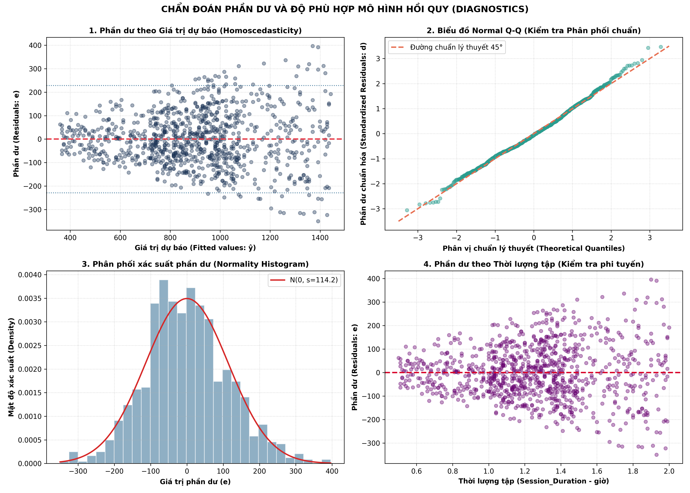

# CHƯƠNG 4 (PHẦN 2): PHÂN TÍCH PHẦN DƯ & TƯƠNG QUAN TUYẾN TÍNH

**Người thực hiện**: Nguyễn Văn Nam Khánh & Nguyễn Thị Thảo

## 1. Cơ sở lý thuyết toán học (Định lý 9, 10 & Biến đổi Fisher Z)

### 1.1. Phân tích phần dư & Giả thiết phương sai thuần nhất (Homoscedasticity)
Phần dư thô là độ lệch giữa giá trị quan sát thực tế và giá trị dự báo từ mô hình bình phương bé nhất:
$$e_i = y_i - \hat{y}_i = y_i - (\hat{\beta}_0 + \hat{\beta}_1 x_i), \quad i = 1, \dots, n$$
Phần dư chuẩn hóa (Standardized Residual):
$$d_i = \frac{e_i}{s} = \frac{e_i}{\sqrt{MSE}}$$
Theo giả thiết Gauss-Markov, sai số ngẫu nhiên $\varepsilon_i \overset{iid}{\sim} \mathcal{N}(0, \sigma^2)$. Do đó:
1. $E(e_i) = 0$ và tổng $\sum_{i=1}^n e_i = 0$ nhờ có sự hiện diện của hệ số chặn $\hat{\beta}_0$.
2. Đồ thị $e_i$ theo $\hat{y}_i$ phải dao động ngẫu nhiên thành dải băng song song quanh trục hoành 0, không có xu hướng loe hình phễu (Heteroscedasticity) hay uốn lượn (Non-linearity).
3. Đồ thị phân vị chuẩn (Normal Q-Q plot) của $d_i$ bám sát đường thẳng 45°.

### 1.2. Hệ số tương quan tuyến tính Pearson ($r$)
Đo lường mức độ liên kết tuyến tính giữa $X$ và $Y$:
$$r = \frac{S_{xy}}{\sqrt{S_{xx} S_{yy}}} = \frac{\sum_{i=1}^n (x_i - \bar{x})(y_i - \bar{y})}{\sqrt{\sum (x_i - \bar{x})^2 \sum (y_i - \bar{y})^2}}$$
Đặc tính: $-1 \le r \le 1$. Trong hồi quy đơn: $R^2 = r^2$, hệ số góc $\hat{\beta}_1 = r \cdot \frac{s_y}{s_x}$.

### 1.3. Kiểm định hệ số tương quan tổng thể $\rho$
1. **Kiểm định không tương quan ($H_0: \rho = 0$ vs $H_1: \rho \neq 0$ - Định lý 9)**:
   $$t_0 = \frac{r \sqrt{n-2}}{\sqrt{1 - r^2}} \sim t(n - 2)$$
   Miền bác bỏ mức $\alpha$: $|t_0| > t_{\alpha/2, n-2}$. Thống kê này **hoàn toàn tương đương** với kiểm định $t$ cho hệ số góc $\beta_1$ trong hồi quy đơn.
2. **Kiểm định với giá trị $\rho_0 \neq 0$ & Biến đổi Fisher Z (Định lý 10)**:
   Khi $\rho \neq 0$, phân phối mẫu của $r$ bị lệch bất đối xứng nghiêm trọng. R.A. Fisher đề xuất phép biến đổi:
   $$Z = \frac{1}{2} \ln \left(\frac{1 + r}{1 - r}\right) = \text{arctanh}(r)$$
   $Z$ tiệm cận chuẩn rất nhanh: $Z \dot{\sim} \mathcal{N}\left(\mu_Z = \frac{1}{2} \ln \frac{1+\rho}{1-\rho}, \; \sigma_Z^2 = \frac{1}{n-3}\right)$.
   Thống kê kiểm định:
   $$Z_0 = \frac{Z - \mu_{Z0}}{1/\sqrt{n-3}} \sim \mathcal{N}(0, 1)$$
3. **Khoảng tin cậy 95% cho $\rho$**:
   Xác định khoảng tin cậy của $\mu_Z$: $[Z_L, Z_U] = Z \pm z_{\alpha/2} / \sqrt{n-3}$. Sau đó lấy hàm hyperbolic tang đảo:
   $$\rho_L = \tanh(Z_L) = \frac{e^{2 Z_L} - 1}{e^{2 Z_L} + 1}, \qquad \rho_U = \tanh(Z_U) = \frac{e^{2 Z_U} - 1}{e^{2 Z_U} + 1}$$

## 2. Kết quả phân tích phần dư trên dữ liệu thực tế

| Chỉ số chẩn đoán | Giá trị | Ý nghĩa |
|---|---|---|
| Trung bình phần dư (e_bar) | 3.97e-15 | Gần bằng 0 (Bảo toàn tổng e_i = 0) |
| Độ lệch chuẩn phần dư (s) | 114.2044 | Ước lượng sai số chuẩn của mô hình |
| Độ lệch (Skewness) | 0.2129 | Gần 0: phân phối phần dư khá đối xứng |
| Độ nhọn (Kurtosis dư) | 0.2376 | Gần 0: hình chuông tương đồng chuẩn |
| Thống kê Jarque-Bera | 9.6381 | P-value = 8.0744e-03 |
| Thống kê Shapiro-Wilk | 0.9952 | P-value = 3.8416e-03 |
| Số quan sát |d_i| > 2 | 45.0000 | 4.62% (kỳ vọng chuẩn ~ 5%) |
| Số quan sát |d_i| > 3 | 3.0000 | 0.31% (ngoại lai phần dư cực đoan) |

- **Trung bình phần dư**: $\bar{e} = 0.000000 \approx 0$, thỏa mãn tính chất toán học của OLS.
- **Phân phối phần dư**: Độ lệch Skewness = 0.2129 và Kurtosis dư = 0.2376 đều rất gần 0. Tỷ lệ điểm $|d_i| > 2$ là 4.62%, xấp xỉ mức kỳ vọng lý thuyết 5% của phân phối chuẩn tắc.
- **Biến đổi tuyến tính hóa $\ln(Y)$**: Thử nghiệm mô hình $\ln(Y) \sim X$ cho $R^2 = 0.8281$, trong khi mô hình tuyến tính gốc đạt $R^2 = 0.8247$. Do đó quan hệ tuyến tính ban đầu mô tả dữ liệu tốt hơn và không cần thiết phải chuyển sang hàm mũ.

## 3. Suy diễn thống kê về hệ số tương quan Pearson $\rho$

- **Hệ số tương quan mẫu**: $r = 0.9081$, $R^2 = 0.8247$ (tương quan đồng biến rất mạnh).

### 3.1. Kiểm định $H_0: \rho = 0$

- Thống kê $t_0 = (r \sqrt{971}) / \sqrt{1 - r^2} = 67.5920$.
- Giá trị tới hạn hai phía $t_{0.025; 971} = 1.9624$, $P\text{-value} = 0.0000e+00 < 10^{-15}$.
- **Kết luận**: Bác bỏ $H_0$ tuyệt đối. Mối quan hệ tuyến tính giữa thời lượng tập và lượng calo tiêu thụ có ý nghĩa thống kê cao.

### 3.2. Kiểm định Fisher Z cho $H_0: \rho = 0.85$

- Biến đổi Fisher: $Z = \text{arctanh}(0.9081) = 1.5168$, sai số chuẩn $SE(Z) = 1/\sqrt{970} = 0.0321$.
- Giá trị kỳ vọng dưới $H_0$: $\mu_{Z0} = \text{arctanh}(0.85) = 1.2562$.
- Thống kê kiểm định: $Z_0 = (Z - \mu_{Z0}) / SE(Z) = 8.1182$.
- Giá trị tới hạn hai phía $z_{0.025} = 1.9600$, $P\text{-value} = 4.7328e-16$.
- **Kết luận**: $Z_0 > z_{0.025}$ $\rightarrow$ Bác bỏ $H_0$, hệ số tương quan thực tế $\rho$ lớn hơn đáng kể so với mức $0.85$.

### 3.3. Khoảng tin cậy 95% cho $\rho$

- Khoảng tin cậy của $Z$: $[1.4539, 1.5797]$.
- **Khoảng tin cậy 95% cho $\rho$**: $[0.8965, 0.9186]$. Với độ tin cậy 95%, hệ số tương quan tuyến tính của tổng thể nằm chắc chắn trong dải rất hẹp từ 0.8965 đến 0.9186.

## 4. Tương quan đa biến & Vấn đề Biến giấu mặt (Lurking Variables)

### 4.1. Ma trận tương quan Pearson giữa các chỉ số thể chất

| Biến | Calories_Burned | Session_Duration | Avg_BPM | Max_BPM | Weight (kg) | Fat_Percentage | Age |
|---|---|---|---|---|---|---|---|
| Calories_Burned | 1.0000 | 0.9081 | 0.3397 | 0.0021 | 0.0954 | -0.5976 | -0.1547 |
| Session_Duration | 0.9081 | 1.0000 | 0.0160 | 0.0101 | -0.0137 | -0.5815 | -0.0199 |
| Avg_BPM | 0.3397 | 0.0160 | 1.0000 | -0.0398 | 0.0097 | -0.0073 | 0.0360 |
| Max_BPM | 0.0021 | 0.0101 | -0.0398 | 1.0000 | 0.0571 | -0.0091 | -0.0171 |
| Weight (kg) | 0.0954 | -0.0137 | 0.0097 | 0.0571 | 1.0000 | -0.2255 | -0.0363 |
| Fat_Percentage | -0.5976 | -0.5815 | -0.0073 | -0.0091 | -0.2255 | 1.0000 | 0.0024 |
| Age | -0.1547 | -0.0199 | 0.0360 | -0.0171 | -0.0363 | 0.0024 | 1.0000 |

### 4.2. "Tương quan không đồng nghĩa với Nhân quả" (Correlation does NOT imply Causation)
Mặc dù $r = 0.9081$ giữa `Calories_Burned` và `Session_Duration` là rất cao, ta **không thể kết luận** thời lượng tập là nguyên nhân duy nhất dẫn đến việc đốt cháy calo:
1. **Biến can thiệp cường độ tim mạch (`Avg_BPM`, `Max_BPM`)**: Nhịp tim phản ánh cường độ gắng sức của tim và cơ bắp. Cùng một thời lượng tập $1$ giờ, người tập ở nhịp tim $160$ BPM sẽ tiêu hao lượng calo vượt trội so với người duy trì nhịp tim $110$ BPM.
2. **Biến nhân trắc học (`Weight`, `Age`, `Fat_Percentage`)**: Người có khối lượng cơ thể lớn hơn tiêu tốn nhiều công năng cơ học hơn cho cùng một động tác vận động.
3. **Loại hình bài tập (`Workout_Type`)**: Bài tập kháng lực tạ (Strength) hay bài tập ngắt quãng cường độ cao (HIIT) có tốc độ đốt calo theo phút khác biệt hoàn toàn so với Yoga hay Cardio nhẹ.

**Định hướng phát triển**: Để loại bỏ tác động nhiễu của các biến giấu mặt và ước lượng tác động thuần túy của thời lượng tập, bắt buộc phải mở rộng mô hình sang **Hồi quy tuyến tính bội (Multiple Linear Regression)**:
$$\text{Calories\_Burned} = \beta_0 + \beta_1 \cdot \text{Session\_Duration} + \beta_2 \cdot \text{Avg\_BPM} + \beta_3 \cdot \text{Weight} + \dots + \varepsilon$$

## 5. Đồ thị chẩn đoán thực nghiệm

