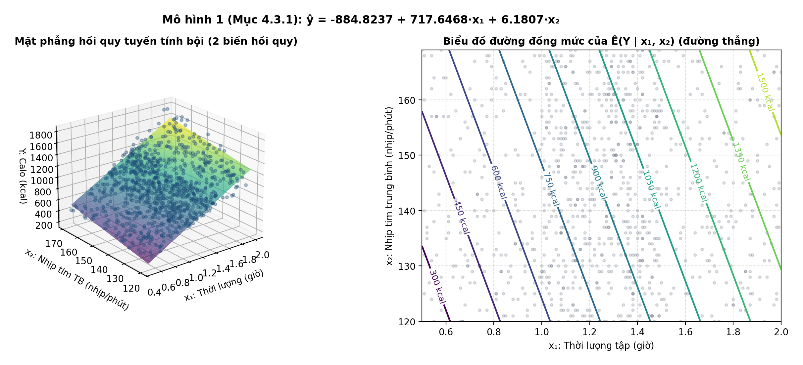
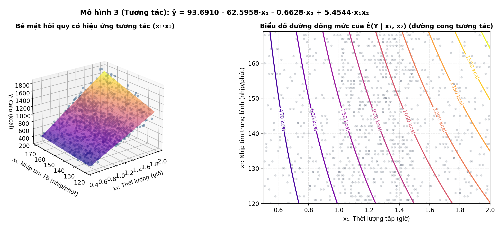

# Chương 4 (phần 3): Hồi quy tuyến tính bội (Mục 4.3.1 và 4.3.2)

## 1. Giới thiệu về mô hình hồi quy tuyến tính bội (Mục 4.3.1)

Trong hồi quy tuyến tính đơn (Mục 4.1), mô hình chỉ xét một biến độc lập $x$ (`Session_Duration`), dễ dẫn đến vi phạm giả thiết về sai số ngẫu nhiên khi các yếu tố khác cũng tác động đến biến phụ thuộc $Y$ (`Calories_Burned`). Mô hình hồi quy tuyến tính bội tổng quát với $k$ biến độc lập (biến hồi quy, biến giải thích) $x_1, x_2, \dots, x_k$ có dạng:

$$Y = \beta_0 + \sum_{j=1}^{k} \beta_j x_j + \varepsilon$$

trong đó $\beta_0$ là **hệ số chặn**, $\beta_1, \dots, \beta_k$ là **các hệ số góc** chưa biết (còn gọi là **các hệ số hồi quy riêng** hay **các hệ số hồi quy lý thuyết**), và $\varepsilon$ là **sai số ngẫu nhiên** đại diện cho các yếu tố ngoài $x_1, \dots, x_k$ có tác động đến $Y$ nhưng chưa đưa vào mô hình.

Với giả thiết $E(\varepsilon) = 0$, **hàm hồi quy tuyến tính lý thuyết** của $Y$ theo $k$ biến giải thích là:

$$E(Y \mid x_1, \dots, x_k) = \beta_0 + \sum_{j=1}^{k} \beta_j x_j$$

Trong mô hình bội, hệ số hồi quy riêng $\beta_j$ biểu thị sự thay đổi kỳ vọng (dự kiến) của biến phản hồi $Y$ trên mỗi đơn vị thay đổi của $x_j$ khi tất cả các biến hồi quy còn lại $x_i$ ($i \ne j$) được giữ không đổi. Ngoài ra, mô hình có **hiệu ứng tương tác** giữa hai biến $x_1, x_2$ biểu diễn bởi thuật ngữ tích chéo $x_1 x_2$:

$$Y = \beta_0 + \beta_1 x_1 + \beta_2 x_2 + \beta_{12} x_1 x_2 + \varepsilon$$

vẫn là một mô hình hồi quy tuyến tính bội (khi đặt $x_3 = x_1 x_2$ và $\beta_3 = \beta_{12}$) vì tuyến tính theo các tham số $\beta$.

## 2. Phương pháp ước lượng bình phương nhỏ nhất (Mục 4.3.2)

Với $k$ biến hồi quy và $n = 973 > k$ quan sát $(x_{i1}, x_{i2}, \dots, x_{ik}; y_i)$, mỗi quan sát thỏa mãn $y_i = \beta_0 + \sum_{j=1}^k \beta_j x_{ij} + \varepsilon_i$. **Hàm bình phương nhỏ nhất** là:

$$L = \sum_{i=1}^{n} \varepsilon_i^2 = \sum_{i=1}^{n} \left( y_i - \beta_0 - \sum_{j=1}^{k} \beta_j x_{ij} \right)^2$$

Lấy đạo hàm riêng của $L$ theo $\beta_0, \beta_1, \dots, \beta_k$ và đặt bằng $0$ thu được hệ $p = k + 1$ **phương trình chuẩn bình phương nhỏ nhất**:

$$\begin{cases} n\hat{\beta}_0 + \hat{\beta}_1 \sum_{i=1}^n x_{i1} + \dots + \hat{\beta}_k \sum_{i=1}^n x_{ik} = \sum_{i=1}^n y_i \\ \hat{\beta}_0 \sum_{i=1}^n x_{ij} + \hat{\beta}_1 \sum_{i=1}^n x_{ij} x_{i1} + \dots + \hat{\beta}_k \sum_{i=1}^n x_{ij} x_{ik} = \sum_{i=1}^n x_{ij} y_i, \quad j = 1, \dots, k \end{cases}$$

Nghiệm $(\hat{\beta}_0, \hat{\beta}_1, \dots, \hat{\beta}_k)$ của hệ phương trình chuẩn (giải bằng phương pháp khử Gauss) là các **ước lượng bình phương nhỏ nhất** của hệ số hồi quy.

## 3. Kết quả thực nghiệm trên dữ liệu phòng gym ($n = 973$)

### 3.1. Hệ phương trình chuẩn bình phương nhỏ nhất của Mô hình 1 ($k = 2$, $p = 3$)

Xét $Y$: `Calories_Burned` (kcal), $x_1$: `Session_Duration` (giờ), $x_2$: `Avg_BPM` (nhịp/phút).

| Phương trình chuẩn | Hệ số β̂₀ | Hệ số β̂₁ (x₁) | Hệ số β̂₂ (x₂) | Vế phải (Σ) |
|---|---|---|---|---|
| PT 1 (∂L/∂β₀ = 0) | 973.0000 | 1222.5000 | 139885.0000 | 880976.0000 |
| PT 2 (∂L/∂β₁ = 0) | 1222.5000 | 1650.3548 | 175831.3900 | 1189434.7200 |
| PT 3 (∂L/∂β₂ = 0) | 139885.0000 | 175831.3900 | 20310825.0000 | 127946246.0000 |

Giải hệ 3 phương trình chuẩn trên cho phương trình mặt phẳng hồi quy ước lượng:
$$\hat{y} = -884.8237 + 717.6468 x_1 + 6.1807 x_2$$

### 3.2. Tổng hợp ước lượng bình phương nhỏ nhất cho các mô hình

| Mô hình | Tham số | Ước lượng bình phương nhỏ nhất | Ý nghĩa |
|---|---|---|---|
| Mô hình 1 (2 biến) | β̂₀ (Hệ số chặn) | -884.8237 | Hệ số chặn mặt phẳng hồi quy |
| Mô hình 1 (2 biến) | β̂₁ (Session_Duration) | 717.6468 | Thay đổi kỳ vọng calo khi tăng 1 giờ tập (giữ Avg_BPM không đổi) |
| Mô hình 1 (2 biến) | β̂₂ (Avg_BPM) | 6.1807 | Thay đổi kỳ vọng calo khi tăng 1 nhịp/phút (giữ Session_Duration không đổi) |
| Mô hình 2 (3 biến) | β̂₀ (Hệ số chặn) | -982.7905 | Hệ số chặn siêu phẳng hồi quy |
| Mô hình 2 (3 biến) | β̂₁ (Session_Duration) | 718.7967 | Hệ số hồi quy riêng của Session_Duration (giữ Avg_BPM, Weight không đổi) |
| Mô hình 2 (3 biến) | β̂₂ (Avg_BPM) | 6.1609 | Hệ số hồi quy riêng của Avg_BPM (giữ Session_Duration, Weight không đổi) |
| Mô hình 2 (3 biến) | β̂₃ (Weight (kg)) | 1.3454 | Hệ số hồi quy riêng của Weight (giữ Session_Duration, Avg_BPM không đổi) |
| Mô hình 3 (Tương tác) | β̂₀ (Hệ số chặn) | 93.6910 | Hệ số chặn bề mặt hồi quy có tương tác |
| Mô hình 3 (Tương tác) | β̂₁ (Session_Duration) | -62.5958 | Hệ số góc bậc nhất của Session_Duration |
| Mô hình 3 (Tương tác) | β̂₂ (Avg_BPM) | -0.6628 | Hệ số góc bậc nhất của Avg_BPM |
| Mô hình 3 (Tương tác) | β̂₁₂ (x₁·x₂) | 5.4544 | Hệ số thuật ngữ tích chéo (hiệu ứng tương tác giữa x₁ và x₂) |

### 3.3. So sánh giá trị cực tiểu hàm bình phương nhỏ nhất $L$

| Mô hình | Số biến hồi quy (k) | Số PT chuẩn (p = k+1) | Hàm bình phương nhỏ nhất L | Mức giảm L so với hồi quy đơn (%) | Sai số đạo hàm riêng max |∂L/∂βⱼ| |
|---|---|---|---|---|---|
| Hồi quy đơn (Mục 4.1) | 1 | 2 | 12664417.7878 | 0.0000 | 0.0000 |
| Mô hình 1: x₁, x₂ (Mục 4.3) | 2 | 3 | 5025418.3600 | 60.3186 | 1.09e-08 |
| Mô hình 2: x₁, x₂, x₃ (Mục 4.3) | 3 | 4 | 4234331.8991 | 66.5651 | 4.16e-08 |
| Mô hình 3: x₁, x₂, x₁x₂ (Tương tác) | 3 | 4 | 4337153.8663 | 65.7532 | 8.73e-09 |

### 3.4. Minh họa hiệu ứng tương tác giữa thời lượng tập và nhịp tim trung bình

Với Mô hình 3 ($\hat{y} = 93.6910 - 62.5958 x_1 - 0.6628 x_2 + 5.4544 x_1 x_2$):
- Khi giữ nhịp tim ở mức thấp $x_2 = 120$ nhịp/phút, tăng thời lượng tập $x_1$ từ $0.5$ lên $2.0$ giờ làm lượng calo kỳ vọng tăng thêm **+887.90 kcal** (tốc độ 591.93 kcal/giờ).
- Khi giữ nhịp tim ở mức cao $x_2 = 170$ nhịp/phút, cùng mức tăng $x_1$ từ $0.5$ lên $2.0$ giờ làm lượng calo kỳ vọng tăng thêm **+1296.98 kcal** (tốc độ 864.66 kcal/giờ).
- Điều này thể hiện rõ bản chất **hiệu ứng tương tác**: tác động của việc thay đổi $x_1$ phụ thuộc vào mức độ của biến $x_2$, và các đường đồng mức trên mặt phẳng $(x_1, x_2)$ bị uốn cong thay vì là đường thẳng.

## 4. Đồ thị mặt phẳng, bề mặt hồi quy và đường đồng mức

